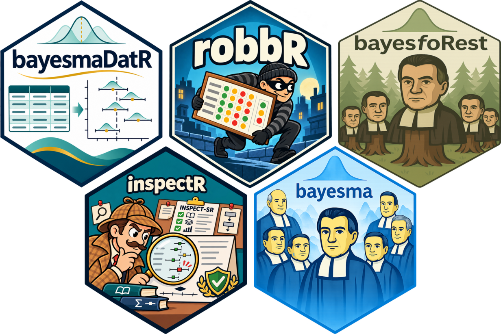

# Bayes-Metaverse: Tools, Methods and Resources for Bayesian Meta-Analysis

> A transparent, reproducible workflow for Bayesian meta-analysis — from data extraction to interpretation.

**Bayes-Metaverse** is a suite of R packages, practical guidance and links to established software for Bayesian meta-analysis. It is organised around a **workflow rather than a single model**: different reviews need different likelihoods, effect measures, priors and sensitivity analyses, and the workflow makes those choices explicit and documents why they were made.

Start with the package you need today. Each works on its own, and they share data structures so they fit together as your review grows.

<p align="center">
  
</p>

## Packages

| Package | Purpose | Links |
|---|---|---|
| **bayesmaDatR** | Shiny app for structured data extraction and entry, producing analysis-ready meta-analysis data | [GitHub](https://github.com/BLMoran/bayesmaDatR) · [Docs](https://blmoran.github.io/bayesmaDatR/) |
| **inspectR** | Assess and document study trustworthiness using the INSPECT-SR framework | [GitHub](https://github.com/BLMoran/inspectR) |
| **robbR** | Create and present risk-of-bias visualisations | [GitHub](https://github.com/BLMoran/robbR) · [Docs](https://blmoran.github.io/robbR/) |
| **bayesma** | Fit, check, compare and interpret Bayesian meta-analysis models using Stan | [GitHub](https://github.com/BLMoran/bayesma) · [Docs](https://blmoran.github.io/bayesma/) |
| **bayesfoRest** | Forest plots and visualisations that bring posterior results and study-level information together | [GitHub](https://github.com/BLMoran/bayesfoRest) · [Docs](https://blmoran.github.io/bayesfoRest/) |

A package for **Bayesian sequential meta-analysis** (trial sequential analysis) is also in development.

All packages are currently **experimental**: interfaces may change before a first CRAN release.

## Installation

Install the whole suite with the `bayesmetaverse` meta-package:

```r
install.packages("remotes")
remotes::install_github("bayesian-metaverse/bayesmetaverse")
```

Or install individual packages, e.g.:

```r
remotes::install_github("BLMoran/bayesmaDatR")
```

`bayesma` uses Stan via [cmdstanr](https://mc-stan.org/cmdstanr/); see the [bayesma installation guide](https://blmoran.github.io/bayesma/) for setting up CmdStan.

## Learn more

- 📖 [Bayes-Metaverse website](https://bayesian-metaverse.github.io/bayesmetaverse/)
- 🧭 [Getting Started: the full workflow](https://bayesian-metaverse.github.io/bayesmetaverse/articles/bayesmetaverse.html)

## Get involved

- **Bugs and feature requests:** open an issue in the relevant package repository, or in [bayesmetaverse](https://github.com/bayesian-metaverse/bayesmetaverse/issues) if you're not sure which package.
- **Questions and ideas:** use [GitHub Discussions](https://github.com/bayesian-metaverse/bayesmetaverse/discussions).
- **Contributions:** pull requests are welcome.

## Team

- **Benjamin Moran** — author, maintainer
- **Thomas Payne** — author

## Acknowledgements

Built on the work of the [Stan Development Team](https://mc-stan.org/) and the [INSPECT-SR](https://doi.org/10.1136/bmj-2024-082233) team, and inspired by [tidyverse](https://www.tidyverse.org/), [easystats](https://easystats.github.io/easystats/), [fastverse](https://fastverse.org/) and [metaverse](https://rmetaverse.github.io/).

Bayes-Metaverse packages are released under the MIT License.
